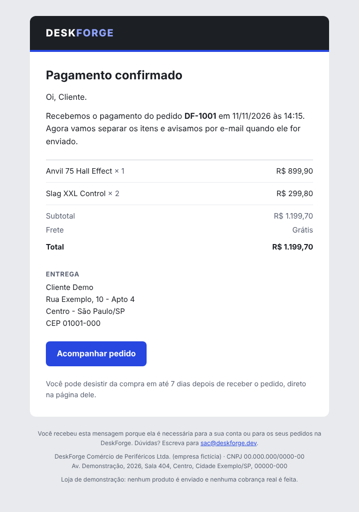
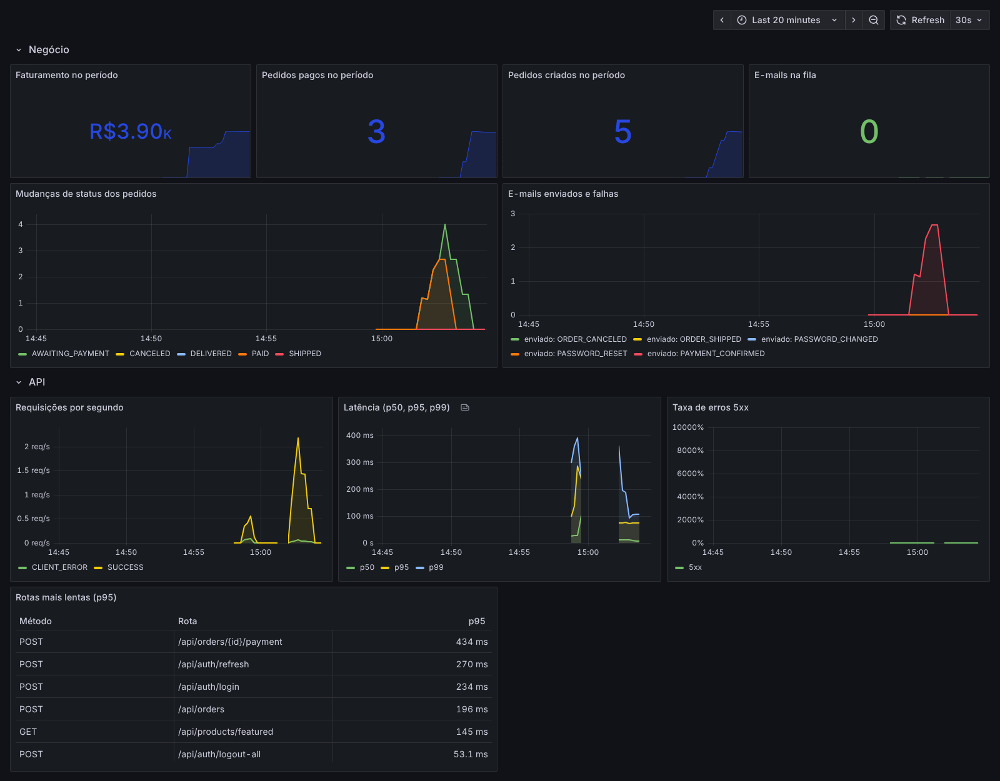

# DeskForge

E-commerce full stack de periféricos e acessórios de setup, com **Spring Boot 4 (Java 21)**, **PostgreSQL** e **React 19**. Resolve os problemas reais de uma loja virtual: estoque à prova de concorrência, máquina de estados de pedidos, autenticação com JWT, banco com privilégios mínimos e conformidade com a legislação brasileira (CDC, Decreto 7.962/2013, LGPD e Marco Civil da Internet).

> A empresa, os produtos e o CNPJ são fictícios. Nenhum pagamento é processado.


## Destaques

- **Estoque à prova de concorrência.** O checkout bloqueia as linhas dos produtos com `SELECT ... FOR UPDATE` em ordem de id, sem deadlocks. Um teste de integração dispara 8 compras simultâneas da última unidade e garante que só 1 é aprovada.
- **Máquina de estados de pedidos.** `AGUARDANDO_PAGAMENTO → PAGO → ENVIADO → ENTREGUE`, com cancelamento validado no domínio e devolução automática do estoque.
- **Reserva com prazo.** Um job agendado cancela os pedidos não pagos em 30 minutos e libera os produtos.
- **Direito de arrependimento (art. 49 do CDC).** O cliente cancela pela própria conta em até 7 dias após a entrega, com estorno solicitado ao gateway.
- **Pagamento com Stripe Checkout.** O cliente paga na página hospedada do Stripe, então dados de cartão nunca passam pela loja. A confirmação chega por webhook com assinatura verificada e é idempotente: eventos repetidos são ignorados. Se um pagamento chegar depois de o pedido expirar, ele é estornado automaticamente. A interface `PaymentGateway` também tem uma implementação simulada, usada por padrão.
- **E-mails transacionais confiáveis.** Pagamento confirmado, pedido enviado, pedido cancelado, redefinição e alteração de senha. Cada e-mail é gravado numa tabela de saída (*transactional outbox*) na mesma transação que muda o pedido, então nunca se perde nem sai duplicado, mesmo com webhooks repetidos. Um job envia em segundo plano com novas tentativas (1, 5, 15 e 60 minutos) e apaga o conteúdo depois da entrega. Templates em Thymeleaf, com versão HTML e texto puro.
- **Recuperação de senha segura.** O link vale 30 minutos e só uma vez, o banco guarda apenas o hash SHA-256 do token, a resposta não revela se o e-mail tem conta e o token vai no fragmento da URL (`#token=`), que não chega a logs de servidor nem ao cabeçalho `Referer`.
- **Sessões seguras.** O token de acesso (JWT) dura 15 minutos e fica só na memória da página, longe do `localStorage`. A sessão vive num cookie `HttpOnly`, `Secure` e `SameSite=Strict`, com refresh token opaco guardado como hash e girado a cada uso. Se um token já girado aparecer de novo (sinal de roubo), toda a sessão é derrubada. Trocar a senha, excluir a conta ou clicar em *Sair de todos os dispositivos* encerra todas as sessões.
- **Limite de tentativas.** Login (5 erros por conta e 30 por IP a cada 15 minutos), cadastro e recuperação de senha respondem `429` com `Retry-After` quando passam do limite. O nginx sobrescreve o `X-Forwarded-For`, para que ninguém fuja do limite forjando o IP.
- **Pronta para ficar no ar.** As imagens são publicadas no GitHub Container Registry a cada push. Um Compose de produção sobe tudo atrás do Caddy com HTTPS automático, e o deploy na VPS acontece sozinho pelo GitHub Actions quando o servidor está configurado. No modo *demo pública*, as contas de demonstração compartilhadas não podem ser sequestradas nem excluídas, o painel admin vira somente leitura e os dados pessoais dos visitantes aparecem mascarados.
- **Observabilidade.** Métricas Prometheus numa porta interna (HTTP, JVM, pool do banco e métricas de negócio: faturamento, pedidos por status, fila de e-mails, logins bloqueados, reuso de sessão), dashboard do Grafana provisionado, 7 regras de alerta, logs em JSON (ECS) em produção e um `X-Request-Id` que liga cada resposta às linhas de log da requisição.
- **Banco com privilégios mínimos.** As migrations rodam com o usuário dono do schema, e a aplicação conecta com um usuário que só tem `SELECT`, `INSERT`, `UPDATE` e `DELETE`. Regras de negócio críticas também são garantidas por `CHECK` no próprio PostgreSQL.
- **LGPD de verdade.** Coleta mínima, consentimento granular de cookies com registro de prova, exportação dos dados em JSON, exclusão de conta por anonimização (os pedidos ficam guardados por obrigação fiscal) e formulário de direitos do titular com protocolo e prazo.
- **Marco Civil da Internet.** Guarda de registros de acesso (IP, data e hora) por 6 meses e expurgo automático depois desse prazo.
- **Acessibilidade WCAG 2.2 AA.** Navegação completa por teclado, foco visível, link para pular ao conteúdo, contraste verificado, erros de formulário associados aos campos e suporte a `prefers-reduced-motion`.
- **Ilustrações originais em SVG.** Nenhuma imagem de terceiros, então não há risco de direitos autorais. A vitrine é uma mesa vista de cima, interativa e navegável por teclado.

## Telas

| Produto | Catálogo |
| --- | --- |
|  |  |

| Painel administrativo | Política de Privacidade |
| --- | --- |
|  |  |

| E-mail de pagamento confirmado | Versão mobile |
| --- | --- |
|  |  |



## Stack

| Camada | Tecnologias |
| --- | --- |
| API | Java 21, Spring Boot 4.1, Spring Security 7, Spring Data JPA (Hibernate 7), Bean Validation, Flyway, springdoc-openapi, JJWT, Stripe Java, Spring Mail, Thymeleaf, Micrometer |
| Banco | PostgreSQL 17 |
| Web | React 19, TypeScript, Vite, React Router, TanStack Query, Tailwind CSS 4 |
| Testes | JUnit 5, AssertJ, Spring Security Test, Testcontainers, GreenMail |
| Infra | Docker Compose, Nginx, Caddy, Mailpit, Prometheus, Grafana, GitHub Actions, GitHub Container Registry |

## Arquitetura

```
deskforge/
├── backend/                     API REST (Spring Boot)
│   └── src/main/java/com/deskforge/
│       ├── auth/                JWT, sessões com refresh token, limites de tentativa e recuperação de senha
│       ├── catalog/             Produtos, categorias, busca com Specifications
│       ├── order/               Checkout, máquina de estados, expiração de pedidos
│       ├── payment/             PaymentGateway, Stripe Checkout, webhooks e modo simulado
│       ├── notification/        Outbox de e-mails, templates Thymeleaf e envio com novas tentativas
│       ├── privacy/             Consentimento, direitos do titular, exportação e anonimização
│       ├── support/             SAC com protocolo e prazo de resposta
│       ├── audit/               Registros de acesso (Marco Civil) e retenção
│       ├── admin/               Indicadores do painel
│       ├── store/               Dados do fornecedor, frete e tributos aproximados
│       ├── demo/                Proteções da demo pública (contas compartilhadas, painel somente leitura, máscara de dados)
│       └── shared/              Erros RFC 9457, limitador de tentativas, request id, tokens seguros
├── frontend/                    Loja e painel (React)
├── infra/
│   ├── postgres/                Script que cria o usuário restrito da aplicação
│   ├── pgadmin/                 Conexão pré-configurada do pgAdmin
│   ├── prometheus/              Coleta de métricas e regras de alerta
│   └── grafana/                 Fonte de dados e dashboard provisionados
├── deploy/                      Compose de produção, Caddyfile (HTTPS) e modelo de .env
└── docker-compose.yml           PostgreSQL + API + Web + Mailpit (+ pgAdmin, Prometheus e Grafana opcionais)
```

Regras de negócio ficam nas entidades (`Order`, `Product`), e os serviços orquestram transações. Todos os erros seguem o formato **Problem Details (RFC 9457)**, com mensagens em português e erros por campo.

## Como rodar

Pré-requisito: Docker Desktop. Primeiro crie o arquivo de configuração a partir do modelo e troque as senhas:

```bash
cp .env.example .env
```

Para gerar o `JWT_SECRET`: `openssl rand -base64 48`. O `.env` está no `.gitignore` e nunca vai para o repositório.

### Tudo com Docker

```bash
docker compose up --build
```

- Loja: http://localhost:3000
- API: http://localhost:8080
- Documentação da API (Swagger): http://localhost:8080/swagger-ui.html
- Caixa de e-mails de teste (Mailpit): http://localhost:8025
- Métricas e saúde da API (porta interna): http://localhost:8081/actuator/prometheus

Para subir também o Prometheus e o Grafana:

```bash
docker compose --profile observability up -d
```

O Grafana abre em http://localhost:3001 (usuário `admin`, senha do `GRAFANA_ADMIN_PASSWORD`) já com o dashboard *DeskForge: visão geral*. O Prometheus fica em http://localhost:9090, com as regras de alerta em *Alerts*.

### Em modo de desenvolvimento

```bash
docker compose up -d db mailpit

cd backend
./mvnw spring-boot:run        # lê o ../.env automaticamente

cd ../frontend
npm install
npm run dev                   # http://localhost:5173
```

O cookie de sessão é `Secure`. Chrome, Edge e Firefox aceitam esse tipo de cookie em `http://localhost`; no Safari, use `COOKIE_SECURE=false` no `.env` só para desenvolvimento.

### Contas de demonstração

| Perfil | E-mail | Senha |
| --- | --- | --- |
| Cliente | cliente@deskforge.dev | Cliente@2026 |
| Admin | admin@deskforge.dev | Admin@2026 |

## Pagamentos com Stripe (opcional)

Por padrão o pagamento é simulado. Para usar o Stripe em modo de teste:

1. Crie uma conta em stripe.com e copie a chave secreta de teste (`sk_test_...`) em *Desenvolvedores → Chaves de API*.
2. Instale o [Stripe CLI](https://docs.stripe.com/stripe-cli) e encaminhe os webhooks para a API:
   ```bash
   stripe login
   stripe listen --forward-to localhost:8080/api/payments/stripe/webhook \
     --events checkout.session.completed,checkout.session.expired,checkout.session.async_payment_succeeded,checkout.session.async_payment_failed
   ```
3. No `.env`, preencha:
   ```
   PAYMENT_PROVIDER=stripe
   STRIPE_SECRET_KEY=sk_test_...
   STRIPE_WEBHOOK_SECRET=            # cole o valor completo exibido pelo stripe listen
   ```
4. Pague com o cartão de teste `4242 4242 4242 4242`, qualquer data futura e qualquer CVC.

A API se recusa a iniciar com uma chave `sk_live_`, para que o projeto nunca cobre de verdade.

## E-mails

Em desenvolvimento, nenhum e-mail sai para a internet: todos são capturados pelo [Mailpit](https://mailpit.axllent.org), que mostra a caixa de entrada em http://localhost:8025. Faça uma compra ou clique em *Esqueci minha senha* na tela de login e o e-mail aparece lá em poucos segundos.

| E-mail | Quando é enviado |
| --- | --- |
| Pagamento confirmado | O pagamento é aprovado (webhook do Stripe ou modo simulado) |
| Pedido enviado | O admin marca o pedido como enviado |
| Pedido cancelado | Cancelamento pelo cliente, pela loja ou por falta de pagamento, informando se houve estorno |
| Redefinir senha | O cliente pede um link em `/esqueci-senha` (no máximo um por minuto) |
| Senha alterada | A senha é trocada pelo link, como alerta de segurança |

Para enviar de verdade, aponte para qualquer SMTP no `.env` (por exemplo, Brevo, Amazon SES ou Resend):

```
MAIL_HOST=smtp.seu-provedor.com
MAIL_PORT=587
MAIL_USERNAME=...
MAIL_PASSWORD=...
MAIL_SMTP_AUTH=true
MAIL_SMTP_STARTTLS=true
MAIL_FROM=DeskForge <nao-responda@seu-dominio.com>
```

Se o servidor de e-mail cair, nada se perde: as mensagens ficam pendentes na tabela `email_outbox` e são reenviadas automaticamente. Depois de 5 tentativas, ficam marcadas como `FAILED` para análise.

## Sessões e limites

| Peça | Como funciona |
| --- | --- |
| Token de acesso | JWT assinado (HS256), 15 minutos, enviado no cabeçalho `Authorization` e mantido só em memória |
| Sessão | Refresh token aleatório de 256 bits no cookie `df_session` (`HttpOnly`, `Secure`, `SameSite=Strict`, `Path=/api/auth`), válido por 14 dias. O banco guarda só o hash SHA-256 |
| Renovação | Quando a API responde `401`, o site chama `POST /api/auth/refresh` uma única vez, recebe um novo par de tokens e repete a requisição |
| Rotação e reuso | Cada refresh revoga o token usado. Se ele aparecer de novo depois de 30 segundos, todos os tokens daquela sessão são revogados e o evento vira métrica e alerta |
| Encerramento | `POST /api/auth/logout` (este navegador), `POST /api/auth/logout-all` (todos), troca de senha e exclusão de conta |
| Limites | Login: 5 erros por conta e 30 por IP em 15 min. Cadastro: 10 por IP por hora. Esqueci a senha: 5 por IP em 15 min. Redefinir senha: 10 por IP em 15 min |

Os limites ficam em memória, o que basta para uma instância. Com várias réplicas, o próximo passo seria guardá-los no Redis.

## Observabilidade

| O quê | Onde |
| --- | --- |
| Saúde (liveness e readiness) | `:8081/actuator/health`, usada pelo `HEALTHCHECK` da imagem |
| Métricas Prometheus | `:8081/actuator/prometheus`, numa porta que não é publicada para a internet |
| Métricas de negócio | `deskforge_orders_revenue_BRL_total`, `deskforge_orders_transitions_total`, `deskforge_emails_pending`, `deskforge_emails_sent_total`, `deskforge_emails_failures_total`, `deskforge_auth_logins_total`, `deskforge_auth_refresh_reuse_total` |
| Alertas | API fora do ar, mais de 5% de erros 5xx, p95 acima de 1 s, fila de e-mails parada, e-mail que esgotou as tentativas, reuso de refresh token e excesso de logins bloqueados (`infra/prometheus/alerts.yml`) |
| Logs | Texto legível no desenvolvimento e JSON no formato ECS em produção (`LOGGING_STRUCTURED_FORMAT_CONSOLE=ecs`), sempre com o `requestId` |
| Rastreio de requisição | Cabeçalho `X-Request-Id` gerado pelo nginx (ou aceito do cliente, se for válido), devolvido na resposta e gravado em cada linha de log |

## Deploy

A pasta `deploy/` sobe a loja em qualquer servidor Linux com Docker, como uma VPS da Hetzner, DigitalOcean ou Oracle Cloud, com HTTPS automático pelo Caddy (Let's Encrypt).

1. Aponte um domínio (registro `A`) para o IP do servidor e libere as portas 80 e 443.
2. No servidor:
   ```bash
   git clone https://github.com/Arthur-Schultz/deskforge.git ~/deskforge
   cd ~/deskforge/deploy
   cp .env.example .env          # preencha domínio, senhas, JWT_SECRET e SMTP
   docker compose -f compose.prod.yml up -d
   ```
3. Opcional: `docker compose -f compose.prod.yml --profile observability up -d` sobe Prometheus e Grafana. O Grafana fica só em `127.0.0.1:3001`; acesse com `ssh -L 3001:localhost:3001 usuario@servidor`.

**Imagens:** a cada push na `main` com CI verde, o GitHub Actions publica `ghcr.io/arthur-schultz/deskforge-api` e `deskforge-web` com as tags `latest` e o SHA do commit. Na primeira publicação, deixe os dois pacotes públicos em *GitHub → Packages → Package settings*, ou rode `docker login ghcr.io` no servidor.

**Deploy automático:** crie no repositório os secrets `DEPLOY_HOST`, `DEPLOY_USER` e `DEPLOY_SSH_KEY`. A partir daí, cada push na `main` atualiza o servidor com a versão exata do commit. Sem esses secrets, o job apenas avisa e termina.

**Demo pública:** com `PUBLIC_DEMO=true` (padrão em produção), as contas `cliente@deskforge.dev` e `admin@deskforge.dev` continuam abertas para qualquer visitante, mas não podem trocar a senha, encerrar as sessões de todos nem ser excluídas. O painel admin fica somente leitura e mostra nomes, e-mails e endereços dos clientes mascarados. O site avisa no checkout para não usar dados reais na conta compartilhada. E-mails para os domínios de `MAIL_SUPPRESSED_DOMAINS` (por padrão `deskforge.dev`, `example.com` e `test.com`) nunca são enviados.

**Backup do banco:**
```bash
docker compose -f compose.prod.yml exec db sh -c 'pg_dump -U "$POSTGRES_USER" -Fc "$POSTGRES_DB"' > backups/deskforge-$(date +%F).dump
```

## Banco de dados

| Usuário | Usado por | Permissões |
| --- | --- | --- |
| `POSTGRES_USER` (deskforge) | Flyway, nas migrations | Dono do schema |
| `DATABASE_USERNAME` (deskforge_app) | API em tempo de execução | Apenas leitura e escrita de dados |

O schema é versionado pelo Flyway em `backend/src/main/resources/db/migration`, e o Hibernate apenas valida o mapeamento. Além de chaves estrangeiras e `UNIQUE`, o banco garante com `CHECK` os status válidos, os valores dos pedidos (`total = subtotal + frete`), e-mails em minúsculas e preços promocionais coerentes. As colunas `updated_at` são mantidas por trigger.

Para ver as tabelas no navegador, suba o pgAdmin (perfil opcional):

```bash
docker compose --profile tools up -d
```

Acesse http://localhost:5050. O servidor **DeskForge** já aparece configurado; ao abrir, informe a senha do `DATABASE_USERNAME`. Todas as portas ficam restritas a `127.0.0.1`.

> O script que cria o usuário restrito só roda na primeira inicialização do volume. Se você já tinha subido o banco antes, recrie com `docker compose down -v`.

## Testes

```bash
cd backend
mvn verify
```

São 24 testes unitários (domínio de pedidos, regras de frete, JWT, novas tentativas de e-mail, limitador de tentativas, refresh tokens) e 34 de integração com PostgreSQL real via Testcontainers e um servidor SMTP em memória (GreenMail). Eles cobrem segurança, compra concorrente, devolução de estoque, webhooks do Stripe (assinatura, idempotência, expiração e estorno automático), envio de e-mails sem duplicidade, recuperação de senha, cookies de sessão com rotação e detecção de reuso, bloqueio por tentativas, as proteções da demo pública e as métricas na porta de gerenciamento. É preciso ter o Docker rodando. O GitHub Actions executa os testes da API e o lint e o build do front a cada push.

## Mapa de conformidade

| Requisito | Onde está |
| --- | --- |
| Identificação do fornecedor (Decreto 7.962, art. 2º) | Rodapé e `GET /api/store` |
| Resumo do contrato antes da compra (art. 4º) | Resumo do checkout com frete, total e tributos |
| Atendimento em até 5 dias (art. 4º) | `/contato`, com protocolo e data limite |
| Direito de arrependimento (CDC, art. 49) | Cancelamento em Meus pedidos e `POST /api/orders/{id}/cancellation` |
| Transparência de tributos (Lei 12.741/2012) | Tributos aproximados no carrinho, no checkout e no pedido |
| Base legal e minimização (LGPD, arts. 6º e 7º) | Cadastro com nome, e-mail e senha. Política de Privacidade com tabela de finalidades |
| Direitos do titular (LGPD, art. 18) | `/lgpd`, exportação JSON e exclusão de conta |
| Consentimento de cookies | Banner com opções equivalentes de aceitar e recusar e registro em `cookie_consents` |
| Guarda de registros (Marco Civil, art. 15) | `AccessLogFilter` + expurgo após 6 meses |
| Acessibilidade (LBI, art. 63) | `/acessibilidade` e implementação WCAG 2.2 AA |
| Sem avaliações ou promessas falsas | Não há avaliações de clientes. Toda condição exibida é aplicada pelo sistema |
| Direitos autorais | Ilustrações e marca originais, fontes self-hosted e `/creditos` |

## Roadmap

- [x] **v1:** catálogo, carrinho, checkout com controle de concorrência, JWT, painel admin, páginas legais e LGPD
- [x] **v2:** Stripe Checkout em modo de teste com webhooks idempotentes
- [x] **v3:** e-mails transacionais assíncronos com outbox, templates Thymeleaf e recuperação de senha
- [x] **v4:** refresh token em cookie HttpOnly com rotação, encerramento das sessões ao trocar a senha e limitação de tentativas
- [x] **v5:** imagens no GHCR, deploy com HTTPS automático, modo demo pública, métricas, dashboard, alertas e logs estruturados

## Licença

[MIT](LICENSE)
