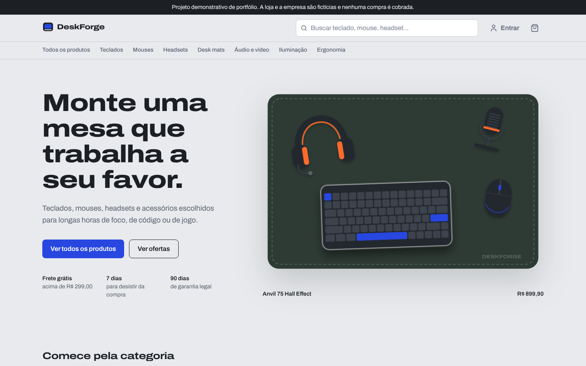
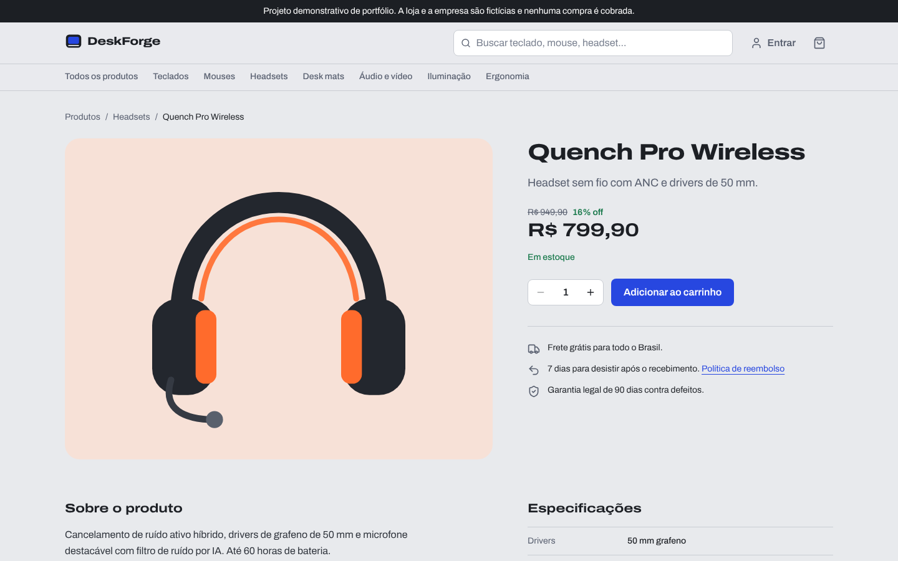
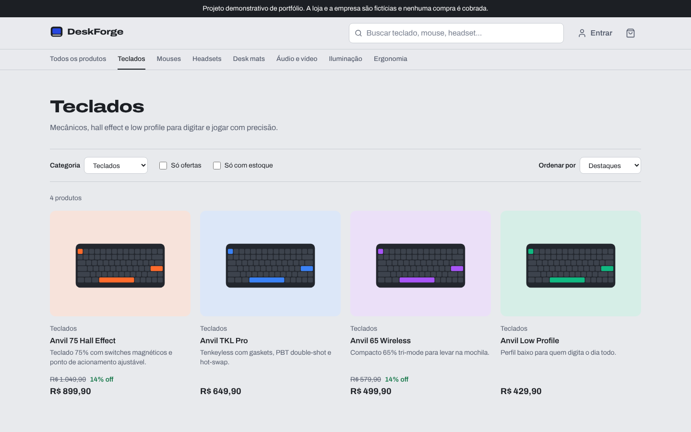
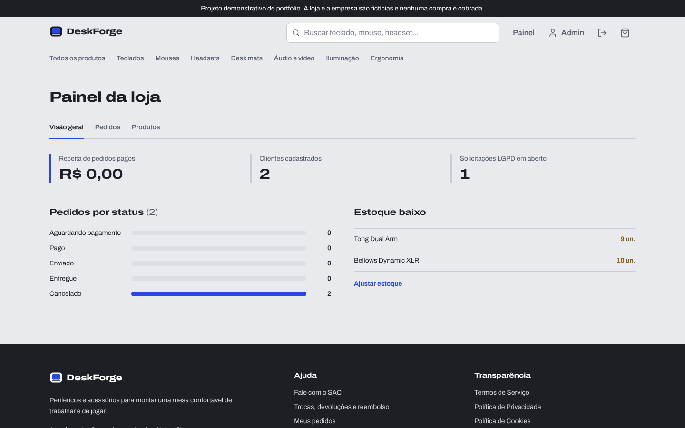
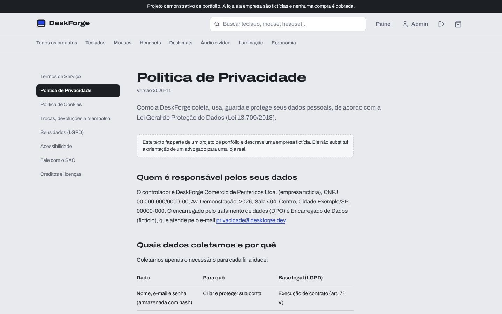

# DeskForge

E-commerce full stack de periféricos e acessórios de setup, com **Spring Boot 4 (Java 21)** e **React 19**. É um projeto de portfólio feito para resolver problemas reais de uma loja virtual: concorrência no estoque, máquina de estados de pedidos, autenticação com JWT e conformidade com a legislação brasileira (CDC, Decreto 7.962/2013, LGPD e Marco Civil da Internet).

> A loja, a empresa, os produtos e o CNPJ são fictícios. Nenhum pagamento é processado.



## Destaques

- **Estoque à prova de concorrência.** O checkout bloqueia as linhas dos produtos com `SELECT ... FOR UPDATE` em ordem de id, sem deadlocks. Um teste de integração dispara 8 compras simultâneas da última unidade e garante que só 1 é aprovada.
- **Máquina de estados de pedidos.** `AGUARDANDO_PAGAMENTO → PAGO → ENVIADO → ENTREGUE`, com cancelamento validado no domínio e devolução automática do estoque.
- **Reserva com prazo.** Um job agendado cancela os pedidos não pagos em 30 minutos e libera os produtos.
- **Direito de arrependimento (art. 49 do CDC).** O cliente cancela pela própria conta em até 7 dias após a entrega, com estorno solicitado ao gateway.
- **Gateway de pagamento plugável.** A interface `PaymentGateway` tem hoje uma implementação simulada. O Stripe entra na v2 sem mudar o domínio.
- **LGPD de verdade.** Coleta mínima, consentimento granular de cookies com registro de prova, exportação dos dados em JSON, exclusão de conta por anonimização (os pedidos ficam guardados por obrigação fiscal) e formulário de direitos do titular com protocolo e prazo.
- **Marco Civil da Internet.** Guarda de registros de acesso (IP, data e hora) por 6 meses e expurgo automático depois desse prazo.
- **Acessibilidade WCAG 2.2 AA.** Navegação completa por teclado, foco visível, link para pular ao conteúdo, contraste verificado, erros de formulário associados aos campos e suporte a `prefers-reduced-motion`.
- **Ilustrações originais em SVG.** Nenhuma imagem de terceiros, então não há risco de direitos autorais. A vitrine é uma mesa vista de cima, interativa e navegável por teclado.

## Telas

| Produto | Catálogo |
| --- | --- |
|  |  |

| Painel administrativo | Política de Privacidade |
| --- | --- |
|  |  |

<p align="center"></p>

## Stack

| Camada | Tecnologias |
| --- | --- |
| API | Java 21, Spring Boot 4.1, Spring Security 7, Spring Data JPA (Hibernate 7), Bean Validation, Flyway, springdoc-openapi, JJWT |
| Banco | PostgreSQL 17 |
| Web | React 19, TypeScript, Vite, React Router, TanStack Query, Tailwind CSS 4 |
| Testes | JUnit 5, AssertJ, Spring Security Test, Testcontainers |
| Infra | Docker Compose, Nginx, GitHub Actions |

## Arquitetura

```
deskforge/
├── backend/                     API REST (Spring Boot)
│   └── src/main/java/com/deskforge/
│       ├── auth/                JWT, filtro de autenticação, regras de acesso
│       ├── catalog/             Produtos, categorias, busca com Specifications
│       ├── order/               Checkout, máquina de estados, expiração de pedidos
│       ├── payment/             PaymentGateway e implementação simulada
│       ├── privacy/             Consentimento, direitos do titular, exportação e anonimização
│       ├── support/             SAC com protocolo e prazo de resposta
│       ├── audit/               Registros de acesso (Marco Civil) e retenção
│       ├── admin/               Indicadores do painel
│       ├── store/               Dados do fornecedor, frete e tributos aproximados
│       └── shared/              Erros RFC 9457 (Problem Details), paginação, configuração
├── frontend/                    Loja e painel (React)
└── docker-compose.yml           PostgreSQL + API + Web
```

Regras de negócio ficam nas entidades (`Order`, `Product`), e os serviços orquestram transações. Todos os erros seguem o formato **Problem Details (RFC 9457)**, com mensagens em português e erros por campo.

## Como rodar

### Tudo com Docker

```bash
docker compose up --build
```

- Loja: http://localhost:3000
- API: http://localhost:8080
- Documentação da API (Swagger): http://localhost:8080/swagger-ui.html

### Em modo de desenvolvimento

```bash
docker compose up -d db

cd backend
./mvnw spring-boot:run        # ou mvn spring-boot:run

cd ../frontend
npm install
npm run dev                   # http://localhost:5173
```

### Contas de demonstração

| Perfil | E-mail | Senha |
| --- | --- | --- |
| Cliente | cliente@deskforge.dev | Cliente@2026 |
| Admin | admin@deskforge.dev | Admin@2026 |

## Testes

```bash
cd backend
mvn verify
```

São 15 testes unitários (domínio de pedidos, regras de frete, JWT) e 8 de integração com PostgreSQL real via Testcontainers, cobrindo segurança, compra concorrente e devolução de estoque. É preciso ter o Docker rodando. O GitHub Actions executa os testes da API e o lint e o build do front a cada push.

## Mapa de conformidade

| Requisito | Onde está |
| --- | --- |
| Identificação do fornecedor (Decreto 7.962, art. 2º) | Rodapé e `GET /api/store` |
| Resumo do contrato antes da compra (art. 4º) | Resumo do checkout com frete, total e tributos |
| Atendimento em até 5 dias (art. 4º) | `/contato`, com protocolo e data limite |
| Direito de arrependimento (CDC, art. 49) | Cancelamento em Meus pedidos e `POST /api/orders/{id}/cancellation` |
| Transparência de tributos (Lei 12.741/2012) | Tributos aproximados no carrinho, no checkout e no pedido |
| Base legal e minimização (LGPD, arts. 6º e 7º) | Cadastro com nome, e-mail e senha. Política de Privacidade com tabela de finalidades |
| Direitos do titular (LGPD, art. 18) | `/lgpd`, exportação JSON e exclusão de conta |
| Consentimento de cookies | Banner com opções equivalentes de aceitar e recusar e registro em `cookie_consents` |
| Guarda de registros (Marco Civil, art. 15) | `AccessLogFilter` + expurgo após 6 meses |
| Acessibilidade (LBI, art. 63) | `/acessibilidade` e implementação WCAG 2.2 AA |
| Sem avaliações ou promessas falsas | Não há avaliações de clientes. Toda condição exibida é aplicada pelo sistema |
| Direitos autorais | Ilustrações e marca originais, fontes self-hosted e `/creditos` |

## Roadmap

- [x] **v1:** catálogo, carrinho, checkout com controle de concorrência, JWT, painel admin, páginas legais e LGPD
- [ ] **v2:** Stripe Checkout em modo de teste com webhooks idempotentes
- [ ] **v3:** e-mails transacionais (confirmação, recuperação de senha) assíncronos com templates Thymeleaf
- [ ] **v4:** refresh token em cookie HttpOnly e limitação de tentativas de login
- [ ] **v5:** deploy público e observabilidade

## Licença

[MIT](LICENSE)
